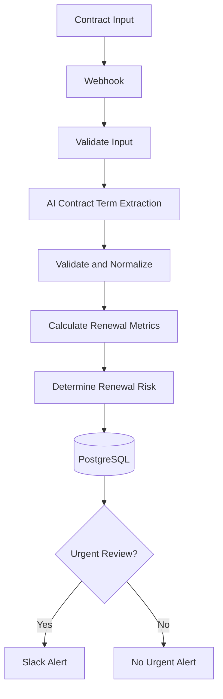

# Contract Renewal Risk Automation

An AI-powered contract renewal risk workflow built with **n8n, an LLM, PostgreSQL, and Slack**.

## Overview

Organizations often manage multiple SaaS and vendor contracts with different renewal dates, notice periods, auto-renewal clauses, and annual contract values. Tracking these details manually can create operational overhead and increase the risk of missing important cancellation or renewal deadlines.

This project automates the process of extracting key contract terms, validating the extracted data, calculating renewal deadlines, identifying contracts requiring urgent attention, recording the results, and notifying the team through Slack.

The objective is to turn contract information into an actionable workflow rather than simply generating an AI summary.

## Business Problem

Missing a contractual notice deadline can lead to an unwanted renewal or an avoidable financial commitment.

Manual tracking becomes more difficult when teams manage contracts across multiple vendors, departments, and renewal dates.

## Solution

The workflow combines AI-assisted information extraction with deterministic business rules and external integrations.

1. Receive contract information through a webhook.
2. Validate the incoming input.
3. Use AI to extract relevant contract terms.
4. Validate and normalize the extracted information.
5. Calculate notice deadlines and remaining time.
6. Determine renewal risk using explicit business rules.
7. Store the result in PostgreSQL.
8. Send a Slack alert when the contract meets the urgent-review condition.

## Workflow Architecture

*The diagram represents the intended logical flow. Refer to the exported n8n workflow for the exact node configuration and connections.*

## Technology Stack

- **n8n:** Workflow orchestration and integration.
- **LLM / AI model:** Extraction of structured contract information from supplied contract text or input.
- **Webhook:** Workflow entry point.
- **PostgreSQL:** Persistent storage for contract results and audit records.
- **Slack:** Notifications for contracts requiring urgent review.
- **JavaScript:** Validation, normalization, date calculations, and business-rule logic where implemented in Code nodes.

## Example Scenario

Consider a hypothetical contract with these details:

| Field | Example |
|---|---|
| Contract ID | CON-1001 |
| Vendor | Acme Software |
| Renewal date | December 15, 2026 |
| Notice period | 60 days |
| Auto-renewal | Yes |
| Annual value | $24,000 |

The workflow calculates a notice deadline of October 16, 2026. In this example, the contract is classified as `URGENT_REVIEW` because the notice deadline is within 30 days and the annual value is at least $10,000.

The workflow stores the result in PostgreSQL and sends a Slack notification for the urgent-review condition.

*This is a demonstration scenario, not a claim about a real vendor contract.*

## Key Design Decisions

### AI for extraction, deterministic logic for decisions

AI is useful for extracting information from unstructured contract content. However, critical date calculations and risk classification should follow explicit, testable rules.

### Validate AI output before using it

The workflow validates and normalizes extracted information before relying on it for downstream calculations. Invalid or incomplete data should not silently become a business decision.

### Persist results for traceability

PostgreSQL provides a persistent record of processed contract information, subject to the actual database schema and retention configuration.

### Escalate selectively

Slack notifications are conditional. The workflow is designed to alert the team only when the configured urgent-review condition is met, helping reduce unnecessary notifications.

## Getting Started

1. Export the workflow from n8n and save it under `workflow/`.
2. Configure the required AI model credentials.
3. Configure PostgreSQL credentials and create the required table.
4. Configure the Slack integration and target channel.
5. Import the workflow into your n8n instance.
6. Review the webhook path, node parameters, database mappings, and risk thresholds.
7. Test with sample data before enabling real contract processing.

See [`docs/setup-guide.md`](docs/setup-guide.md) for setup details.

## Repository Structure

- `workflow/` — exported n8n workflow.
- `docs/` — architecture, setup, workflow, testing, and security documentation.
- `examples/` — synthetic example inputs and outputs.
- `database/` — database schema used by the project.
- `screenshots/` — screenshots from actual workflow executions.

## Security and Limitations

- Never commit credentials, API keys, webhook secrets, or real confidential contracts.
- AI extraction can be inaccurate; validation and human review remain important.
- Date calculations depend on correctly extracted dates, notice periods, and the applicable business rules.
- `URGENT_REVIEW` is a configured workflow classification, not legal advice or an autonomous contract decision.
- Slack alerts are notifications for human review; they do not cancel, renew, or amend contracts.
- Production deployment would require additional controls such as authentication, monitoring, error handling, access management, and retention policies.

See [`docs/security-and-limitations.md`](docs/security-and-limitations.md).

## Project Status

Portfolio project demonstrating AI-assisted extraction, workflow orchestration, validation, business-rule automation, database persistence, and conditional notifications.

The exported workflow and documentation should be reviewed together to confirm that all described behavior matches the deployed configuration.

## Future Improvements

- Add document upload and extraction from supported file formats.
- Add human approval for high-impact contract decisions.
- Build a dashboard for upcoming renewals and financial exposure.
- Add retry policies, failure alerts, and monitoring.
- Introduce duplicate detection and idempotent processing.
- Add automated tests for date calculations and risk classification.

## Disclaimer

This project is for educational and demonstration purposes. It is not a substitute for legal review or a production contract-management platform.

## Author

Built as part of my journey into AI Automation Engineering, focusing on practical business workflows, reliable AI integration, and connected systems.
